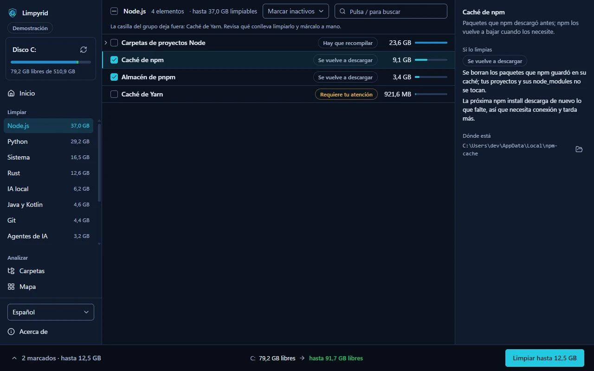
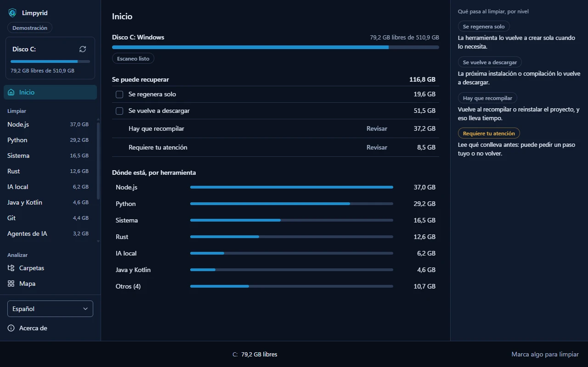
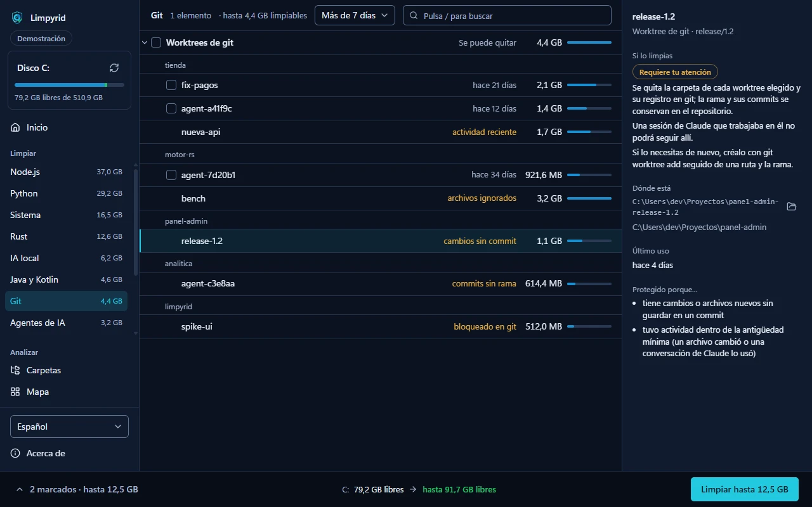

<div align="center">


# Limpyrid

**Recupera tu disco, sin borrar a ciegas.**

Limpyrid es una app de escritorio para Windows que muestra qué ocupa tu disco y limpia, con cuidado, lo que dejan atrás las herramientas de desarrollo: cachés de paquetes, carpetas de proyecto que se regeneran, worktrees de git, datos de Docker y temporales de agentes de IA.<br>
Antes de borrar te dice qué es cada cosa y qué pasa si la limpias.

[](#empezar)
[](LICENSE)
[](#traducir-limpyrid)

[Qué ofrece](#qué-ofrece) · [Cómo protege tus archivos](#cómo-protege-tus-archivos) · [Empezar](#empezar) · [Términos](TERMINOS.md) · [English](#english)

<br>



</div>

> **Estado:** versión 0.1.0, en preparación. Todavía no hay instalador publicado: por ahora se compila desde el código. En un disco real se han probado el escaneo, la protección de rutas, la limpieza de cachés y la de worktrees; la limpieza y la compactación de Docker todavía no.

## Qué ofrece

- **Qué ocupa el disco, de un vistazo.** Escanea una unidad o una carpeta y muestra cuánto se puede recuperar, agrupado por herramienta y por lo que cuesta recuperarlo.
- **Una razón para cada cosa.** Al elegir una fila, el panel de detalle dice qué es, qué pasa si la limpias, dónde está y cuándo se usó por última vez.
- **Cuatro niveles de consecuencia.** Se regenera solo, se vuelve a descargar, hay que recompilar, o requiere tu atención. Lo que requiere atención nunca se marca en bloque.
- **Lo marcado, siempre a la vista.** Una barra fija muestra cuánto llevas marcado y cómo quedaría el disco, hasta que confirmas.
- **Carpetas y Mapa.** Las carpetas ordenadas por tamaño, como lista o como mapa de rectángulos, para investigar lo que no entra en ninguna categoría.
- **Español e inglés**, y un archivo por idioma para añadir más.

<div align="center">

</div>

### Qué reconoce

| Grupo | Ejemplos |
|---|---|
| Sistema | Temp de usuario y de Windows |
| Node | npm, pnpm, Yarn, Bun, Deno, navegadores de Playwright, `node_modules`, `.next`, `.nuxt` |
| Python | pip, uv, Poetry, entornos virtuales, `__pycache__` |
| Go, Rust, Java, .NET, PHP, Dart, C/C++, Zig | sus cachés de paquetes y de compilación |
| Contenedores | Docker y Podman: uso, limpieza y compactación del disco virtual |
| Git | worktrees que ya no están en uso |
| Agentes de IA | temporales de sesiones de Claude por proyecto; cachés de editores |

La lista completa, con cada ruta y la fuente que la confirma, está en [`src-tauri/src/catalog.rs`](src-tauri/src/catalog.rs).

## Cómo protege tus archivos

Limpyrid borra de forma definitiva, así que está construido para negarse ante la duda.

- **Nada se borra sin confirmación**, y la confirmación lista cada elemento y su tamaño.
- **Aviso de uso.** Antes de la primera acción que borra, la app muestra los términos y pide aceptarlos.
- **Rutas bloqueadas:** raíces de unidad, `Windows`, `Program Files`, `ProgramData`, tu carpeta de usuario y `AppData` no se pueden borrar desde ninguna acción. El bloqueo vive en el backend, no en la interfaz, y también cubre rutas de red.
- **Solo lo que se regenera.** Lo que contiene datos tuyos se muestra y no se ofrece limpiar: modelos, discos de WSL, historial de conversaciones, datos de aplicaciones.
- **Antigüedad mínima.** En las carpetas temporales solo se quita lo que no cambió en el plazo que elijas (de 1 a 30 días, nunca menos de 24 horas).
- **Worktrees en uso.** Un worktree no se ofrece si tiene cambios sin guardar, commits que no están en ninguna rama, actividad reciente, archivos ignorados que no volverían (como un `.env`) u otro repositorio adentro. Se quitan con `git worktree remove`, sin forzar, y la rama se conserva.
- **Enlaces.** No se siguen enlaces simbólicos ni junctions: se quita el enlace, nunca su destino.
- **Lo que pide la interfaz no se da por bueno.** El backend vuelve a calcular qué se puede borrar en el momento de hacerlo.

Lo que **no** hace: no envía datos a ningún sitio, no corre con permisos de administrador (salvo al compactar un disco virtual, que lo pide en ese momento) y no borra volúmenes de Docker.

<div align="center">

</div>

## Empezar

Requisitos:

- Windows 10 u 11 con WebView2 (incluido en Windows 11).
- [Rust](https://www.rust-lang.org/tools/install) y [Node.js](https://nodejs.org/) 22 o superior.
- Opcionales, según lo que quieras limpiar: `git`, `docker` o `podman` en el PATH.

```bash
npm install
```

```bash
npm run tauri dev
```

Para generar el ejecutable y el instalador:

```bash
npm run tauri build
```

### Ver la interfaz sin escanear nada

En desarrollo, la interfaz se puede abrir en un navegador con datos de ejemplo. Sirve para revisar el diseño; no escanea ni borra nada.

```bash
npm run dev
```

Luego abre `http://localhost:1420`.

### Pruebas

```bash
cargo test --manifest-path src-tauri/Cargo.toml
```

```bash
npm test
```

```bash
npm run check
```

Las pruebas del backend crean sus propias carpetas temporales y repositorios de prueba; ninguna toca rutas reales del sistema.

## Traducir Limpyrid

Cada archivo `src/lib/i18n/<código>.json` es un idioma, y aparece solo en el selector.

1. Copia `src/lib/i18n/en.json` a `src/lib/i18n/<código>.json`. El nombre del archivo debe ser una etiqueta de idioma válida (`pt`, `pt-BR`), porque se usa para las cifras y las fechas; `npm test` falla si no lo es.
2. Traduce los valores sin tocar las claves ni los `{marcadores}`, y pon en `lang.name` el nombre del idioma en ese idioma.
3. Comprueba con `npm test`. Lo que falte se muestra en inglés y se avisa sin fallar.

## Tecnología

Tauri 2, con el backend en Rust y la interfaz en Svelte 5, TypeScript, Tailwind CSS y componentes de shadcn-svelte.

## Aviso

Limpyrid borra archivos de forma definitiva y quien la usa decide qué se limpia. Se entrega tal cual, sin garantías: revisa la lista antes de confirmar y no limpies nada que no sepas recuperar.

## Términos y licencia

Copyright © 2026 Pergamio.

Limpyrid es software libre bajo la licencia GNU General Public License, versión 3 o posterior (`GPL-3.0-or-later`); el texto completo está en [LICENSE](LICENSE). Los términos de uso, en lenguaje llano, están en [TERMINOS.md](TERMINOS.md); la aplicación los muestra y pide aceptarlos antes de la primera acción que borra.

Docker, Podman, Claude, Node.js, Python, Rust y las demás herramientas nombradas son marcas de sus respectivos dueños; Limpyrid no está afiliado a ninguna.

---

## English

**Limpyrid is a Windows desktop app that shows what is using your disk and carefully cleans what developer tools leave behind:** package caches, project folders that can be rebuilt, git worktrees, Docker data and temporary files from AI agents. Before anything is deleted, it tells you what each item is and what happens if you clean it.

> **Status:** version 0.1.0, in preparation. There is no published installer yet: for now you build it from source. On a real disk, scanning, path protection, cache cleaning and worktree removal have been tested; Docker cleaning and disk compaction have not.

- **What is using the disk, at a glance.** Scan a drive or a folder and see how much can be recovered, grouped by tool and by what it costs to get it back.
- **A reason for everything.** Pick a row and the detail panel says what it is, what happens if you clean it, where it lives and when it was last used.
- **Four consequence levels.** Regenerates by itself, downloads again, needs a rebuild, or needs your attention. Items that need your attention are never selected in bulk.
- **Your selection, always in view.** A fixed bar shows how much you have selected and what the disk would look like, until you confirm.
- **Built to refuse when in doubt.** Nothing is deleted without a confirmation that lists every item. System folders are blocked in the backend. Git worktrees with uncommitted changes, recent activity or unreachable commits are never offered. Temporary folders only lose what has not changed within the minimum age you choose.
- **Private.** It sends no data anywhere.

To build it you need Windows 10 or 11, [Rust](https://www.rust-lang.org/tools/install) and [Node.js](https://nodejs.org/) 22 or later:

```bash
npm install
```

```bash
npm run tauri dev
```

The interface is available in Spanish and English; adding a language is adding one file to `src/lib/i18n/`.

Copyright © 2026 Pergamio. Free software under the GNU General Public License, version 3 or later (`GPL-3.0-or-later`); see [LICENSE](LICENSE). It is provided as is, with no warranty: it deletes files permanently and the person using it decides what gets cleaned. The terms of use are in [TERMINOS.md](TERMINOS.md).
